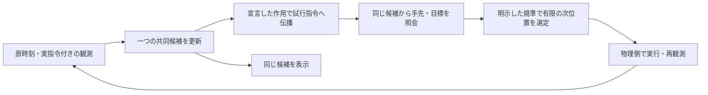

# 不定座標変換デモの簡略化に向けた調査と設計案

2026年10月18日。対象sourceは `493808c`。根拠は [真値・候補幅の介入診断](UNCERTAINTY_ABLATION_20261018.md) の12固定候補と16実走条件、および現在の実装である。本書では新しい実験や実装変更を行っていない。以下の簡略化案を、そのまま現行要件の撤回や性能改善の実証とは扱わない。

## 1. 結論

残したい骨格は、**時刻付き観測から一つの共同候補を更新し、その候補を試行指令へ伝播して規準を評価し、一つの有限な次指令を送ること**である。リンク間の依存、観測履歴、指令依存性、推定と表示の同一性はここに含まれる。

現在の煩雑さは、この骨格の周囲に、身体とKそれぞれの変化仮説、Kの全履歴密度とevidence、内部地図とは別のtask目標、目標を保持するための交差輸送、二階の局所モデル実行器、過去の制御方式が積み重なったことにある。いずれも経緯や目的はあるが、全てを同時に動かすと、どの仮定が結果を作ったのか分けにくい。

私の提案は、次の参照版を段階的に作ることである。

- 共同の身体候補を一つ保持する。未知の環境を推定する場合だけ、その変数も同じ共同状態に入れる。
- 指令作用を一つ明示する。最初は固定した補助Kを使い、オンラインK同定を比較の外へ出す。
- 同じ候補の完全な規準を評価し、有限の次位置を選ぶ。局所Hを力として外挿する二階系を比較から外す。
- 今回の既知の局所取付並進をDiracとして与える構成を試す。各リンクの方位候補と、そこから伝播する位置の広がりは残す。
- その後、身体BFS、K適応、未知地図、視野維持を、必要性を確認しながら個別に戻す。

これは最終機能を全て廃止する提案ではない。特に剛性同定は要求された機能であり、参照版で固定することと、最終版から不要と結論することは異なる。まず各層を単独で評価できる構成を作る、という削減方針である。

最初の制御比較には、記録済みの観測から得たbody・goal・Kを同じ条件で固定して使える。地図を既知にする比較を追加する場合は、診断用の真値援助か、外部較正を与える別の前提として明記する。通常経路へ真のスイッチ位置を混入させる意味ではない。

## 2. 実験から何が分かり、何が分からないか

|観測された結果|導けること|導けないこと|
|---|---|---|
|Markerの固定候補6時点では、リンク方位中心の真値化が局所平衡方向の内向きcos平均を−0.008から0.727へ変えた|この候補群では身体方位が重要。回転幅にも強い感度がある|全時刻・IMUでも同じ順位になること、方位だけ直せば到達すること|
|Marker終端は通常178mm、目標だけ真値化433mm、身体・目標同時補助2.9mm|身体と目標の整合を評価する必要がある|目標を正確にしない方がよいこと。各介入には幅・交差の変更も含む|
|K代表のみ真値化でも両ケース未達。IMUでは約100mmから128mmへ悪化|K誤差だけでは説明できない|Kや指令作用が不要であること|
|正確・狭幅のMarker観測で初回勾配約183倍、H最大固有値約41倍|観測精度が規準の尺度と実行応答も変える|正確なセンサが本質的に有害であること|
|IMU全真値援助は一度1.1mmに近づいた後、約99秒で逸脱|中心・Kの精度だけでは現在の実行系は安定しない|真の確率法則を全て与えても到達不能であること。有限幅・近似・初期K未選定は残る|
|通常の終端身体観測ageはMarker83秒、IMU70秒程度|新しい勾配と新しい観測情報は別。処理負荷も閉ループへ作用する|非同期化が不要であること、古い取得を破棄すれば正しい推定になること|

最も重要な区別は、**候補の推定誤差、規準が好む方向、規準を実行する応答**の三つである。今の失敗を全て推定へ押し戻して、推定機構を追加し続ける根拠はない。一方、BFS・目標cut・Gaussian近似の個別寄与は今回測っていないため、そこを原因と断定して撤去する根拠もない。

## 3. 現在、何を重ねているのか

|層|実際に保持・計算しているもの|骨格との関係|
|---|---|---|
|身体・内部環境|全リンクと未知根元マーカーの共同Gaussian/Bingham代理、全cross|観測履歴を持つ主状態|
|身体の観測更新|全平均・全共分散の変分更新、native観測枝、Keep/Reset、単峰化|更新法と変化モデルが一緒に実行される|
|task目標|更新済み身体と新画像を独立cutで結び、別の根元目標lawとして保持|主状態の内部地図とは異なるtask用構成|
|補助K|各原指令での身体観測後／前の密度比、全因子履歴、別のKeep/Reset、Laplace evidence、数値代表|主状態とは別の適応モデル|
|指令作用|同じ観測身体へ平衡角差を作用させる|将来指令を比較するために必要|
|指令選定|完全task規準Jと独立view因子|taskの設計|
|実行|Fisher型H、ridge、二階系の速度状態、13次元の行列指数、非同期packet切替|現在選んだ制御方式。候補伝播の定義そのものではない|
|取得・表示|取得／身体／K／制御／artifactの非同期処理、原取得・実区間の記録|時刻対応と再現のための実装|

現行は全てを一つの共同Bayes推定として解いているわけではない。主状態、補助K、task用cut、局所実行モデルをそれぞれ計算し、凍結した出自で結んでいる。簡略化では、数式の数だけでなく、この**別のモデルを結び直す箇所**を減らす価値がある。

なお、旧single-step IK、visual approach、marker search、K_execなどはコード・設定に残っているが、現在のrunning-gradient主経路では作動していない。それらの隔離は読みやすさを改善するが、現在の振動や推定負荷がその分だけ減るわけではない。[現行設定](config/moving_estimation.yaml) と [実行分岐](src/probtf_observation_fusion_demo/event_motion.py) を区別して読む必要がある。

## 4. 残すべき最小の数理

### 4.1 一つの共同候補と、前回からの引継ぎ

身体の局所変換列をB、未知の環境変換をEとし、必要な変数の共同候補を $\mu_t(dB,dE)$ とする。環境が正確に既知ならEはDiracとして与えられる。別々のリンク周辺を毎回独立なものとして掛け直さない。

原観測は $(t_i,c_i,z_i)$ として扱う。$c_i$ は取得時点の実送信指令である。最小参照系で変化仮説を外す場合、処理は $\mu_i^-=(A_{c_{i-1}\to c_i}^{\kappa})_*\mu_{i-1}^+$、続いて $\mu_i^+\approx\operatorname{Approx}_{G}\{L_i(z_i\mid B,E)\mu_i^-/\int L_i\,d\mu_i^-\}$ と書ける。$\operatorname{Approx}_{G}$ は既存のGaussian変分更新と全within/betweenの単峰近似を含む記号であり、厳密なBayes事後や厳密モーメントを得たという主張ではない。

ここでAは、原実ledgerの全区間作用を、各区間に保存したK・branch・始終指令で合成したものを表す。端点指令差だけで過去の経路を置換しない。固定Kの新規参照実験でも実ledgerを残す。保存済み実走を再生する場合は、過去区間を新しい固定Kで書き換えない。

観測がmixtureなら $L_i=\sum_k w_{ik}L_{ik}$ を全成分で扱う。内部状態を一つへ近似することと、新観測の一枝を選ぶことは異なる。内部の平均・全共分散には過去の情報が近似的に蓄積される。生の全履歴尤度を厳密に再現できるという意味ではないが、履歴を全て捨てる方式でもない。

この引継ぎ自体が記憶を作る。BFSを付けなければ過去を保持できない、という構造ではない。

### 4.2 現在姿勢だけでなく、指令に対する作用を残す

試行指令qには $\mu_t^q=(A_{c_t\to q}^{\kappa})_*\mu_t$ を対応させる。現在の身体を正しく推定できても、qを変えたときの身体を予測する作用がなければIKは定義できない。

現在は $\Delta\theta=\theta_{eq}(q;K)-\theta_{eq}(c_t;K)$ を同じ観測身体へ作用させる。[stiffness_command.py](src/probtf_observation_fusion_demo/stiffness_command.py) はKから身体を作り直していない。また、一回の制御は捕捉した一つのK代表を使い、K分布の全幅を積分していない。

従って、最初の参照版はKの全履歴密度を動かさず、宣言した固定Kによる同じ作用を使える。固定Kが近似であること、未選定Kとの違い、出自を明示する。真Kを使う場合は診断条件とする。通常の剛体IKへ無言で置き換える案ではない。

### 4.3 手先と目標は、同じ候補から照会する

手先候補は棒取付まで含めた合成のpush-forwardとして得る。身体と目標に依存があるなら、その共同候補から相対変換を照会する。同一座標の位置差に限っても $\operatorname{Cov}(X_H-X_G)=S_H+S_G-C_{HG}-C_{GH}$ であり、crossを零にするだけで別の比較になる。実際の回転・棒の作用は既存coreの伝播で扱う。

一般の目標mixtureは維持する。今回の3×3ボード中央について単峰化が許可されていることを、他の観測にも一律に広げない。推定、指令選定、表示は同じ候補とIDを参照する。表示用の分布や、表示のための再中心化は増やさない。

### 4.4 規準と実行を別々に確認する

現在の規準は、各相対候補のGaussian/Bingham正規化密度 $\ell_{k,t}(q)$ を使う $J_t(q)=-\log\sum_k w_{k,t}\ell_{k,t}(q)$ である。これは現在の全crossを含む相対照会の規準であり、常に独立な手先・目標周辺の積だとは扱わない。

現在の実際の選定規準は、独立なview因子も含む $F_t(q)=J_t(q)+\lambda V_t(q)$ である。最初の実行器だけを比較する段階では、viewの有効／無効・重みも両条件で同じにし、有限端点の評価にも同じFを使う。viewを外す比較は別に行う。

次位置を選ぶ方法と、その位置を物理系へ実行する方法は分ける。最小の比較案は、同じ身体・目標・Kを固定した一回の計算で有限の $q_{next}$ を選び、次の結果までその有限位置を保持する方式である。指令源の時刻と実採用時刻、実際の出発位置が異なる場合も記録する。

これは新しい制御比較案であり、現在のrunning-gradient方式の要件を既に撤回したものではない。旧endpoint実装を丸ごと復活させると、旧QP、位置s条件、K_exec、phaseなども戻り得るため、必要な有限指令の部分だけを切り分ける。過去sourceの到達実績を、現在の推定器での安定性の証拠にはしない。

これは数理上の役割図であり、プロセス数をこの箱の数に変更する提案ではない。物理・取得を推定待ちで止めない構成と、原取得／実区間の記録は残す。

## 5. 優先して削減を検討する箇所

### 5.1 二階局所モデルの実行を、最初の比較から外す

現在は $\dot u=v$、$\dot v=-\gamma v-\eta[g_s+H_s(u-u_s)]$ を非同期に切り替える。単にJを評価する以上に、H近似、ridge、最適化速度、減衰、モデルの有効範囲、切替時の過渡応答を持つ。[局所モデルの仕様](LOCAL_MODEL_TRACKING.md) を参照する。

今回の3件の範囲逸脱は、保存済みg/H・位置・速度・dtから再現できた。IMUの正確なマーカー条件では同じ局所モデルの大きい入力だけで逸脱し、身体＋目標条件では切替と残速度が問題となった。従って、まずこの実行方式を分離する根拠は強い。

比較案は、現在と同じ選定規準Fの一つの降下方向から短い有限候補を作り、同じFを端点で評価して選ぶ方式とする。物理的な許容集合を明示し、端点以後は位置を保持する。Hによる力の外挿と最適化側の速度状態を持たない。少数回の候補評価で有限結果を返すことと、推定・制御全体を品質閾値で停止することは異なる。

ここで外す速度状態は指令生成器のvである。物理シミュレータの関節角速度、慣性、ばね、ダンピングは維持する。物理側を準静的平衡へ戻して比較を簡単にする提案ではない。

sourceでFが減ることは、新観測後のFや実距離の単調減少を保証しない。同じlawでも、非同期採用時の実指令がsource指令と異なれば、sourceからの減少は採用位置からの減少ではない。両位置を記録し、有限端点方式に全閉ループの単調性があると説明しない。古い勾配を単に一定速度として無期限に実行する方式へは戻さない。有限指令比較の改善も未検証である。

### 5.2 局所並進の例示的不定性を、既知幾何と分ける

現在の [直接指定law](../probtf_switch_press_demo/config/independent_transform_laws.yaml) は、6リンク各々の3次元並進に0.5mmの標準偏差を与え、各回転にも3次元の広がりを持たせる。未知マーカー6座標を含めた共同座標は42次元である。Marker baselineの保存された72枝では70枝が支持rank42、2枝がrank41だった。

単一Gaussianでも、支持rank r の全平均・Choleskyを最適化すると変数数は $r+r(r+1)/2$ となる。r=42では945変数／枝である。これは [VIの実装](src/probtf_observation_fusion_demo/variational_conditioning.py) に対応する。「内部は単一Gaussian」だけでは小さい推定問題になっていない。

今回の物理世界は、既知URDFの局所取付位置と関節角の動力学で構成されている。局所取付並進そのものが0.5mmで揺らぐ物理過程を入れたわけではない。そのため、**既知の局所並進を最初からDiracとする事前モデル**は、有力な最小化候補である。

full3次元のBingham方位と未知マーカーを残しても、支持は最大18＋6=24次元、変分変数数は324となる。945から324は変数数の比較であり、計算速度が約3倍になるという実測ではない。初期並進を確定しても、上流の方位とレバーアームから各リンク・棒先端の絶対位置には分布が伝播する。手先位置の不定性を消す提案ではない。

零の並進共分散は既存coreと共同状態のPSD支持で表現でき、設定から初期lawへ渡る。新しいcoreの伝播式や観測後の分散clipを必要とする案ではない。ただし、元の0.5mm priorとは異なるモデルであり、この構成の回帰・実走は未実施である。一般用途では並進不定性を自由に設定できるAPIを維持し、今回の参照設定だけを既知幾何へ合わせる。

さらに既知の関節軸1自由度へ回転も制限する案は、別の段階とする。現在のfull Bingham再表現は3×3回転共分散の正定値逆を必要とするため、rank1回転を同じAPIへ代入するだけでは成立しない。微小分散を足して隠すことはしない。最初は既存のfull3次元Binghamを保った24次元案が現実的である。[coreの表現](../../core/probtf_core/src/probtf/spherical_law/first_order.py) を参照する。

この違いは、物理側が6個の関節角で動くのに対し、推定側が各局所変換に一般の並進・方位変化を許していることに由来する。広い候補族には用途があるが、このデモに必要な自由度かは別に検証できる。今回の残差例だけで全状態の可観測性や識別不能性を証明したとは扱わない。

### 5.3 身体BFSとK BFSを、記憶の仕組みから分離する

現在の設定は身体の変化事前0.25、Kの変化事前0.10で、いずれも有効sensor eventごとである。二つは別の変化モデルであり、共通の一つの変化変数を推定しているわけではない。

N回の適用を通した継続成分の事前係数はそれぞれ $0.75^N$、$0.9^N$ となる。これは事後reset率でも、過去情報がその確率で全消去されるという意味でもない。しかし、同じ物理時間でも選択したイベント数が変わると変化事前の作用が変わり、IMU追加・取得率・間引きが観測情報以外の要因も変える。

固定Kの物理世界を用いた最小参照系では、まず変化仮説を持たない通常の逐次Bayesを比較する理由がある。BFSは非定常性を扱う機能として後から評価する。身体の指令作用の近似誤差や誤観測が残るため、BFSを外すと過信が悪化する可能性もある。今回の実験はBFSの有無を比較しておらず、改善を予告する根拠はない。

### 5.4 内部地図とtask目標の二系統を整理する

現在は内部に共同状態 $(B,E)$ があり、別に更新済み身体とnative画像を独立cutで合成したtask目標Gを持つ。欠測時はGの周辺を凍結し、身体とのcrossだけを明示的に輸送する。このため、同じマーカーに関係する二系統の状態と、その結合規約が必要となった。[fresh goalの仕様](FRESH_OBSERVATION_GOALS.md) にこの違いが記されている。

長期的な最小構成案は、同じ共同状態のEから $T_{BG}=E T_{MG}$ を派生することである。Gを独立した推定記憶として持たず、同じsnapshotから照会する出力にする。試行指令qは身体側だけへ作用し、環境Eをqとともに動かさない。一回の指令選定中は同じ環境lawを使う。

物体が物理的に静止していることと、その位置についての事後推定が更新されないことは異なる。この案では、新情報によってEの事後が変われば推定目標も変わり得る。これは現行のfresh-native構成と、欠測時G周辺を凍結する規定を変更する。単なる同じ変数名の統合として実行してはいけない。

今回の3×3ボード中央の単峰許可を使った参照版なら、この案を明確に定義しやすい。一般のnative観測mixtureをp_goalへ残す場合は、その全枝を派生出力として持つ仕様を別途定める必要がある。内部単峰事後だけから、失った観測modeを後で復元できるとは扱わない。

一方、現lawを変えない整理もある。全goal成分が持つ同じ身体周辺を不変参照として共有し、goalごとの周辺とcrossだけを持つ構造にすれば、重複copyを減らせる。これは内部地図へtaskを統合する変更とは区別できる。

状態を統一しても識別情報は増えない。未知マーカーと柔軟身体を相対画像だけで推定すると、根元に対する共通姿勢誤差を十分拘束できない場合がある。IMU重力もyawを単独では拘束しない。今回の共通ずれとknown_landmark条件の改善は、この点を別に扱う必要性を示すが、厳密なgauge不定性まで同定した結果ではない。

### 5.5 Kの全履歴密度を、最初の参照版の必須要素にしない

主状態の更新が完了しても、K側は身体の観測後／前の比、各取得指令での平衡、履歴密度のscore、二仮説evidenceを別途計算する。制御が使うのは最終的な数値代表一つである。ここには主状態とは別の推定問題が加わっている。

参照版では、宣言した固定補助Kを使って身体推定と制御を先に調べる。K同定は、同じ保存済み身体更新・原指令に対して独立に評価できる。Kが不要と結論したり、Kから身体を再生成する案ではない。

再導入時の候補には、一定Kの通常逐次事後、単一logK Gaussianへの逐次近似などがある。後者は前回事後に情報を圧縮して保持するが、現在の全履歴連続密度と同値ではない。推定規準・近似・保持する情報を定義する必要がある。身体とKを新しい巨大な共同状態へまとめることまで、今回の最小案へ含めない。

## 6. 規準をそのままにする限り、残る本質的な問題

実験では、正しい中心でも、位置規準の共分散変化が離反を報酬した。位置部分は $J_x=\tfrac12e^TS^{-1}e+\tfrac12\log\det S$ であり、その方向微分には $e^TS^{-1}de-\tfrac12e^TS^{-1}(dS)S^{-1}e+\tfrac12\operatorname{tr}(S^{-1}dS)$ がある。距離を悪化させても、中央の項が大きく改善すれば完全Jは下がる。

また、分布を狭くするとgとHの大きさが変わる。同じeta/gammaを使う二階系の減衰比は $\zeta_i=\gamma/(2\sqrt{\eta\lambda_i(H)})$ なので、同じgainのまま観測精度だけを上げることが、実行上は同じ条件にならない。

有限端点方式にしても、完全J自身が好む離反方向は消えない。簡略化後に残る問題は、「このtaskで完全期待尤度をどう選定規準として使うか」という設計判断になる。推定問題とtask規準は別々に定義できる。

共分散をsource値で固定した比較や、位置誤差の二乗期待値を用いた比較は、原因の切り分けには使える。しかし、共分散微分・log determinant・Bingham正規化項を省いて「同じ完全Jを軽くした」と説明してはいけない。規準を変える場合は、別の選定問題として明示する。本書では完全Jの変更を実装していない。

## 7. どの順番で小さくするか

一度に全てを置き換えると、今回の調査で分けた原因が再び混ざる。目指す参照版は小さくしつつ、比較は一段ずつ行う。

|順序|行う比較・整理|確かめるもの|
|---|---|---|
|1|同じ固定body・goal・K・完全J・view設定で、現二階実行と有限次位置方式を比較|候補の更新なしでも生じる過走、規準の降下と実距離の違い、切替応答|
|2|同じ原観測・時刻・実指令・ledgerで、例示的並進priorと既知並進Diracを比較|支持rank、全変数の数、処理時間、絶対姿勢誤差、伝播後の位置共分散|
|3|共通固定Kで身体更新を評価し、身体BFSだけを有／無で比較|過信・観測fit・絶対誤差・情報age。通常Bayesだけで履歴が蓄積すること|
|4|同じ身体・観測入力で、fresh goalと内部地図派生goalを比較|共通ずれ、各周辺とcross、欠測時の推定更新、目標mixtureの意味|
|5|最小版が動いた後、K同定を独立検証して接続し、必要ならview・変化検知を戻す|追加した機能の効果と計算負荷。身体精度、K精度、到達保持を分離|

固定入力の対比較・記録済みrawの再生を先に使う。これらは同じ入力で数値差と処理時間を測れるが、新しい閉ループの到達性能を測ったことにはならない。実際に動作を変えれば、その後の画像も変わる。固定入力で差を説明できてから、現在の動力学・同じsceneで実走する。

各段階で見る出力は、終端距離、最小距離、初到達後の最大距離、実手先弧長、リンク絶対誤差、観測fit、処理した原観測時刻、候補とKの出自、処理時間とする。全てに新しい採否閾値を設ける提案ではなく、何が改善したかを取り違えないための比較項目である。

## 8. 削減しても残す契約

原取得時刻・実送信指令・観測IDと、各実行区間で使った作用を保持する。観測を後の指令のものとして処理しない。推定の近似未達や数値監査を、有限な後続処理の停止条件にしない。必要演算の実失敗は入力とともに記録する。

全リンクcrossと、必要な身体／環境crossを保持する。Bingham由来の既存伝播と単峰近似の意味を明示する。内部の単峰許可を観測mixtureの枝選択へ転用しない。推定・IK・表示は同じ候補を使い、表示のageと現在の制御candidateを区別する。モンテカルロ、表示用の別分布、分散floorやjitterで簡略化を代用しない。

数理モデルを小さくすることと、物理・取得・推定・表示を同期で直列化することは異なる。必要な非同期性を維持し、重複copy・再decode・使われない診断演算を減らす。全rawを捨てたり最新の一件だけを採用して高速化したと説明しない。既存の時間被覆選択は採用・未融合を分けて記録する。

RVizの粒子・軸・画像・視点・レイアウトは、この検討では変更対象にしない。巨大rawや中間生成物をGitへ追加する必要もない。

## 9. 今回の提案の到達点

最初の参照版は、**既知の局所並進、full Bingham方位、全crossを持つ一つのGaussian代理、通常の観測更新、明示した固定指令作用、同じ候補によるtask照会、有限の次指令**で構成する案である。未知地図を含む場合の目標派生、BFS、K適応は、その骨格に何を追加するのかを独立に評価する。

数値状態としては主に共同平均m・全共分散Pと現在指令cを持ち、固定Kは入力、目標は同じsnapshotからの出力、次位置は一回の選定結果とする。未知地図や一般のgoal mixtureが必要な場合の追加状態は明示する。Kの全履歴密度、独立した目標更新系、局所Hと最適化速度までを、最初から必須の状態にしない。

今回の証拠は、この簡略版が既に到達することを示したものではない。一方、現在の複雑さを一括で維持してKやgainだけを調整するより、どの層の失敗かを説明できる構成へ戻す必要性は明確になった。次の実装指示では、まずどの参照版を作るか、現行から変える仮定はどれか、完全Jを維持する比較と変更する比較を分けて指定できる。

## 参照資料

- [真値介入の報告と全結果](UNCERTAINTY_ABLATION_20261018.md)：今回の判断の直接根拠。
- [変分観測更新](VARIATIONAL_MOMENT_UPDATE.md)：固定事前、全mean/P、枝と単峰化の意味。
- [fresh goal構成](FRESH_OBSERVATION_GOALS.md)：内部地図とtask目標の別管理、独立cut、保持規約。
- [局所モデル実行](LOCAL_MODEL_TRACKING.md)：Hの構成と二階系。現在の数式と過去の試行を区別する。
- [指令作用の実装](src/probtf_observation_fusion_demo/stiffness_command.py)：K代表による同じ候補への作用。
- [身体設定](config/moving_estimation.yaml) と [K設定](config/stiffness_identification.yaml)：別々のBFSとそのイベント単位。
- [実走のage・処理件数](validation/uncertainty_ablation_20261018/analysis/CROSS_CASE_RUNTIME_SUMMARY.md)：勾配更新と観測更新の遅れの違い。
