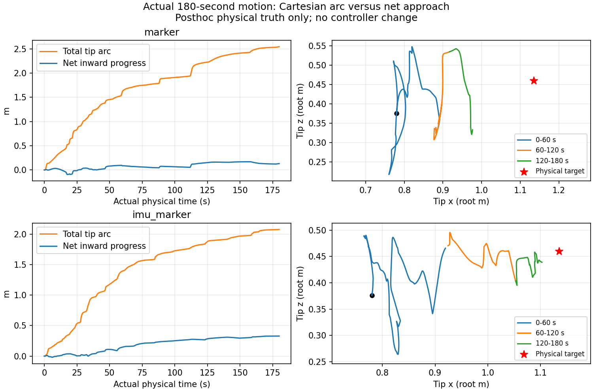

# 接近量に対して横・縦の運動が多い理由

ユーザーの指摘は「接近が全くない」ではなく、「接近しているが、そのために必要な量より余分な運動が大きい」というもの。本記録では、現行source `1244f3fcd838165b040fadc701f6b00f47ada7f6` のMarker単独とIMU併用を各180秒RVizで再実行し、実軌跡と実際に使った指令・候補・完全規準を照合した。推定・制御・物理・ゲイン・速度制約・規準は変更していない。

## 速度制限と実際の運動

現行 `running_gradient` 経路は速度・加速度clipを使っていない。設定に残る0.048 rad/sは旧servo経路の値であり、今回の速度制限ではない。従って「上限速度の枠を横振れが使い切った」という実装ではない。一方、生成された運動に対する接近の効率が低いことは実測で確認できる。

| ケース | 手先の総移動距離 | 目標までの距離の正味短縮 | 短縮／移動距離 |
|---|---:|---:|---:|
| Marker | 2.545 m | 0.130 m | 5.12% |
| IMU＋Marker | 2.076 m | 0.328 m | 15.82% |

Markerの最後60秒は0.342 m動いたが、目標から約9 mm遠ざかった。全180秒の終端距離は239.376 mm／41.190 mmで、両ケース未到達だった。全raw取得と身体処理は終了後の60秒drainで完了したが、Kは19件／223件の未完archiveを保持した。物理動作の終了とK全履歴処理の完了を同一視しない。

原frameと指令区間の照合、radial/tangentの定義、各60秒区間の数値は [軌跡の短報](validation/rerun_1244f3f_20261018/motion/REPORT.md) に記録する。真の目標と実姿勢は後解析のみに使い、制御・推定へ渡していない。

## 完全な位置尤度は、平均距離だけを下げる規準ではない

現在の位置項を $J_x(q)=\frac12 e(q)^\top S(q)^{-1}e(q)+\frac12\log\det S(q)$ と書く。$e$ は同じ比較座標系の推定平均位置と目標位置の差、$S$ はその伝播共分散である。実際には全目標mixtureを保って完全な位置・方位尤度を計算する。以下の代表候補は中央ボードの1成分である。

一つの実速度 $\dot q$ に沿う位置項の変化は $\dot J_x=e^\top S^{-1}\dot e-\frac12 e^\top S^{-1}\dot S S^{-1}e+\frac12\operatorname{tr}(S^{-1}\dot S)$ である。第1項が平均の移動、第2項がMahalanobis誤差に対する共分散の変化、第3項が正規化項に対応する。伝播共分散も指令依存なので、これらは全て現在の規準の微分に含まれる。

このため、平均が遠ざかっても、残差方向の共分散が変化する効果によって、完全Jが下がる場合がある。共分散の変化には幅だけでなく向きの変化も含まれる。「分散を広げた」と一律に説明しない。

Markerの実使用request848、約158.474秒の同じ候補・捕捉K・現在指令で確認した例は次の通り。

| 完全Jの変化に寄与する項 | 実指令速度に沿う値／秒 |
|---|---:|
| 位置の平均移動 | +273.17 |
| 位置Mahalanobis項の共分散変化 | −1713.66 |
| 位置log determinant | +0.392 |
| Bingham負の二次形式 | −153.20 |
| Bingham正規化項 | +0.324 |
| 視野因子 | 0 |
| 完全J合計 | −1592.97 |

この時、推定平均の位置距離は約3.75 mm/s、modal距離は約3.66 mm/sで増えていた。後解析での実距離も約7.16 mm/sで増えていた。単に推定目標へは向かっていて実世界だけで横にずれたという例ではない。

表の方位項は $-r_G^\top A r_G+\log Z(A)$ のJへの寄与として符号を揃えた。位置定数項の微分は零である。全項の速度方向微分の合計は、同じ現在指令での完全Jの速度方向微分に一致した。実使用6候補のsource勾配と実行側の局所勾配も差0で再現した。[目的関数の分解](validation/rerun_1244f3f_20261018/objective/REPORT.md) と原候補ID・全ledger・再現scriptを保存する。

平均移動の悪化を共分散変化による改善が上回り、規準としては降下になっている。実行側の局所勾配 $g_s+H_s(q-q_s)$ と、その現在指令で再評価した完全勾配のcosも約0.9969だった。この代表例では、古い勾配の使い回しだけでなく、現在の完全規準自体が離反する方向を許している。

## Kや物理応答だけの問題とは分ける

後半100–180秒のK作用診断では、保存した実開始姿勢に捕捉Kの記録角度増分を作用させた予測と、実手先変位の方向cosは時間平均0.975／0.947だった。予測側自身が接線主体である。これはoracle始点を使う後解析であり、controllerの候補分布を置き換えた検証ではない。Kの絶対適合や全状態の精度を保証する結果でもない。

予測変位に対して実変位が約0.23–0.25秒遅れる比較で、両者の相関が最大になった。これは物理の時定数を同定した結果ではなく、瞬間のずれをKだけの誤りへ帰属する根拠にもならない。固定局所モデルの固有値から計算した減衰比では、Markerは全採用packetが過減衰、IMUは840件中58件だけが不足減衰で最小比約0.833だった。固定一packetの不足減衰だけで両ケースの運動を説明することもできない。観測・目標・K・packetの切替を含む閉ループ全体とは別の診断である。

## 今回確認した範囲

接近の効率が低いことと、完全な位置尤度の降下が平均距離の悪化を許す実例を確認した。代表6候補の解析であり、全振動をこの一項だけが引き起こしたと断定しない。K・身体の遅延、推定の変化、物理応答は引き続き別の要因である。

共分散微分や正規化項を削ったり、新しい位置条件・重み・速度制限を入れたりはしていない。現在の完全Jを忠実に下げることと、接近を優先して指令を選ぶことは、同じ要求ではない。接近優先へ改める場合は、候補分布そのものを変えず、選定方針に何を要求するかを明示する必要がある。

既存のFisher行列Hを使った $-H^{-1}g$ も同じ6候補で方向だけ比較したが、上のrequest848は前処理後も外向きで、他の多くでは単位関節変位あたりの接近量が減った。この検査だけで、前処理への変更が一般に接近を改善すると主張することもできない。新たな制御方式として採用していない。

再実行の小要約と原出力SHAは [検証資料](validation/rerun_1244f3f_20261018/) に保存する。大容量のraw DB・全JSONL・pickle・中間配列・native binaryはGitへ追加しない。
