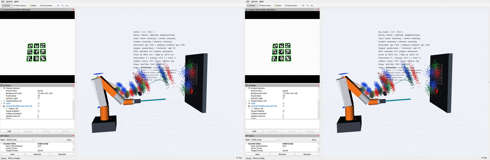
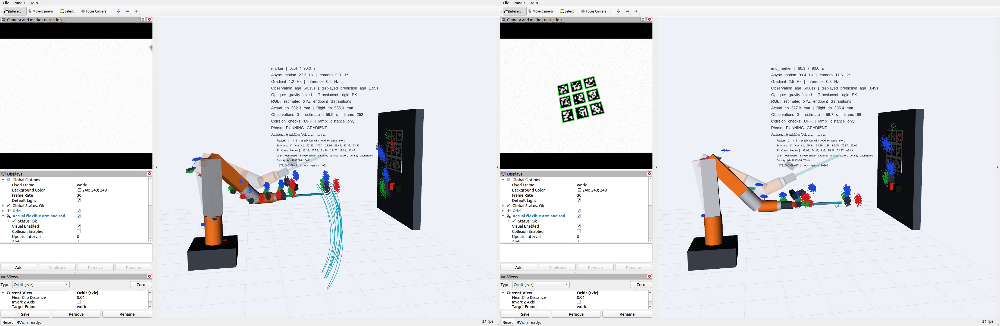
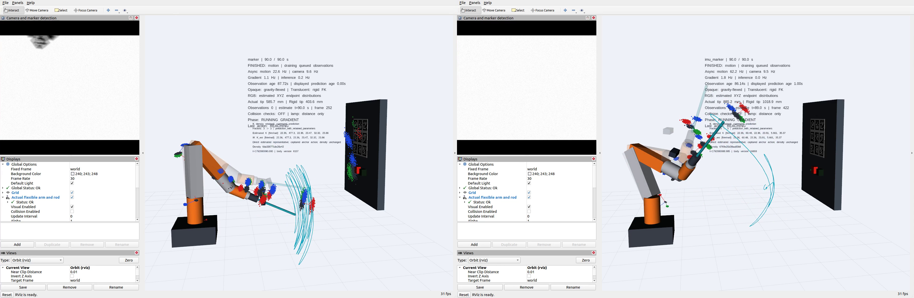
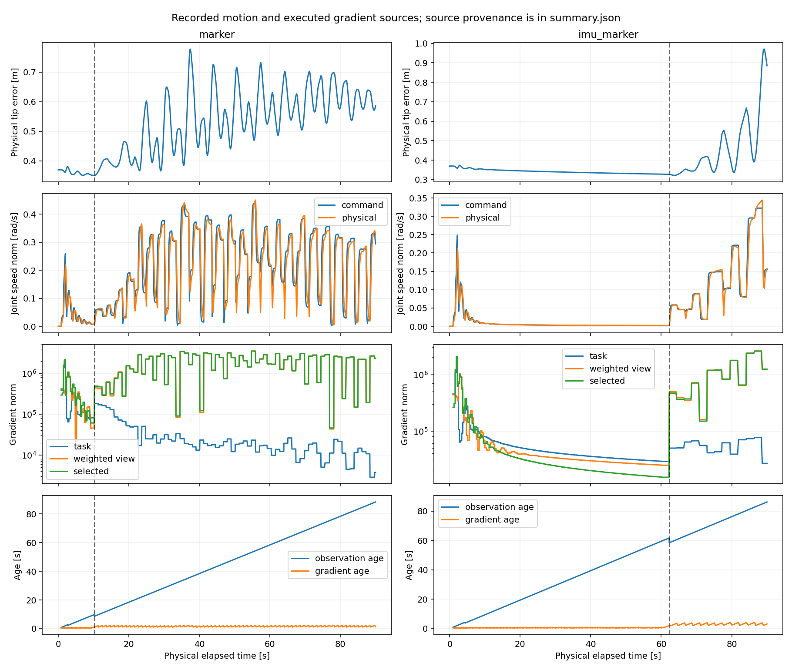

# 90秒試行で見える動作と推定の遅れ

両方とも到達に失敗し、途中から手先が往復する。これは改善結果を示す動画ではなく、異常動作と計算待ちを確認する記録である。左がmarker、右がIMU＋marker。同じscene・viewer・規準・gainで90秒実行した。録画sourceは `d36bae9`、package sourceの開始・終了hashは一致している。

[RViz全尺動画（約29 MB・104.13秒）](../../../recordings/probtf_observation_fusion_demo/runaway_20261018/rviz_marker_and_imu_marker.mp4) · [録画manifest](../../../recordings/probtf_observation_fusion_demo/runaway_20261018/manifest.json) · [数値調査報告](RUNAWAY_INVESTIGATION_20261018.md)

録画は15 fpsで、推定完了Hzではない。90秒の物理動作に加えて開始前・終了後を含む。元の3840×1280録画から、両RVizの1840×1200 client領域をそれぞれcropして横に結合し、3680×1200とした。窓間の28pxを含むRViz外の余白だけを除いている。表示設定や画像・粒子・軸のサイズは変更していない。倍速化、停止時間の切除、成功場面への差替えはしていない。現在状態はscene内の時刻とstatusを読む。

## 開始前：観測をまだ入れていない

動画1秒。両caseのRGB点は同じ初期候補lawからの表示で、modal姿勢は半透明の剛体モデルに沿う。opaqueな腕は重力でたわんだ物理参照であり、初期分布へ代入していない。分布表示だけを別lawへ戻したものでもない。

## 長い推定待ちの間も動作してしまう

動画65秒では、sceneの物理時計がmarker約61.4秒、IMU併用約60.2秒。一方、制御に使える身体観測はそれより約59秒古い。表示の `Observation age` と `displayed prediction age` は別物である。指令履歴で現在へ輸送した分布を表示できても、新しい観測を反映済みという意味にはならない。

左は既に大きい往復軌跡が残る。右はこの直後、物理62.280秒に遅れて完成したbody/goal/Kが採用され、勾配が大きくなり、その後の往復が増す。左も右もKを保持したまま勾配反転が続く区間がある。K更新だけで全ての往復を説明できない。

## 90秒終了：到達せず、推定も未完了

動画98秒。両caseの物理時計は90秒で止まっている。先端誤差はmarker585.7mm、IMU併用885.2mm。根元目標の推定誤差とは別に、opaqueな物理先端の到達で判定した結果である。表示のFINISHEDは物理動作の終了を意味し、全観測の融合完了ではない。未完了stageはmarkerのK evidence、IMU併用の大きい身体バッチで、その時点でもほぼ1coreを使い計算していた。

## 図で動作と待ち時間を対応させる

上から実先端誤差、関節速度norm、task/view/selectedの勾配norm、身体観測と勾配sourceのage。破線は調べた新law/Kの採用時刻で、marker10.244秒、IMU併用62.280秒。norm図だけから方向の反転は読めないため、反転cosine・同K判定は[数値要約](validation/runaway_20261018/gradient_summary.json)を参照する。最後の段の青線は新しい勾配計算が戻っても身体観測自体は古いままであることを示す。

長い推定待ちの主因は共同身体更新と連続K evidence。制御計算の遅れはK捕捉・reanchorと保存の増大。数値代表の選定単独や勾配計算本体だけが遅い、という実測ではなかった。詳しい所要時間、CPU、原source、未確定点は調査報告に記載した。

調査後、全K履歴のJSONを毎回読み直すaccessorの無駄を `d10644f` で修正した。全候補・履歴を保持した同値の読出し最適化である。この動画を最適化後の安定性改善の証拠とはしない。
