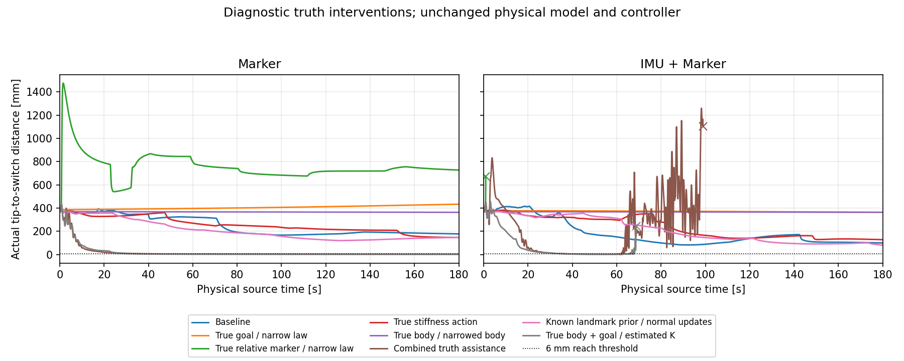
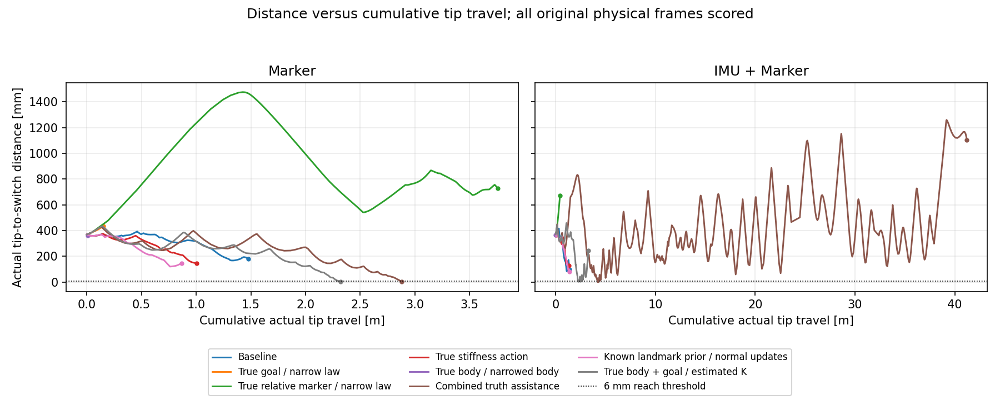

# 不定性と真値の介入による接近動作の切り分け

ユーザーの「１個ずつ真値を与える」「どの不定性が最も悪さをしているのか特定」に対応する診断。数値実装は `1244f3f`、開始時のmainは `efeb1d2`。通常の推定・制御、core、RViz設定は変更しない。真値入力と分布の有限幅の縮小は、この明示した診断に限る。推定・制御にモンテカルロは使わない。

## 結果から分かったこと

Markerの固定候補6時点では、単独介入の中でリンク方位中心の真値化が進行方向を最も大きく変えた。身体の回転幅と目標の幅にも強い感度があった。一方、実走では身体と目標の共通ずれが重要で、目標だけを正すと悪化し、両方を正す条件では約2.9mmまで到達して保持した。片側だけの真値化を、その変数が無関係であるという判定には使えない。

K代表だけの真値化では両ケースとも未達だった。マーカー観測を正確で狭い候補にすると、巨大な初期勾配と低減衰を生じ、Markerは大きく離反、IMU併用は約0.91秒で指令関節範囲を逸脱した。「観測noiseが大きいこと」だけが主因ではない。

さらに、IMU併用では身体・目標・Kを全て真値で補助しても、一度1.1mmまで近づいた後に逸脱した。これは全ての確率法則が真値という条件ではなく、真の中心・Kと明示した狭い候補を与える条件である。凍結候補では共分散依存による離反、実走では曲率・遅延・残速度を含む実行応答の破綻をそれぞれ確認した。従って、修正の優先先を単なる観測幅の縮小やK値の調整に絞る根拠は得られなかった。身体／目標の整合と、同じ分布から作る規準・実行応答を分けて扱う必要がある。

以下は各条件一回の診断であり、全時間・全センサで一つの不定性が支配するという統計的な順位ではない。

## 比較の分け方

一つ目は、以前の180秒実走で実際に使われた候補を固定し、一つの中心・幅・Kだけを変更する対比較である。MarkerとIMU併用の各6候補、計12候補を、30・60・90秒と中終盤から選んだ。全期間の無作為標本や時間平均ではない。元candidate ID、全ledger、原取得時刻・実指令を照合し、元Hは全12例でbitwise一致、勾配の再計算誤差はnorm比5.461e−12以下だった。

二つ目は、現行の `AsyncMotionSession`、5 worker、C++動力学、完全J・視野因子、局所二次モデルの実行器で、各条件を初期状態から180物理秒動かす比較である。ROS公開とRVizを伴わないheadless試行で、以前のGUI実走と性能値を混同しない。同じ物理・初期状態・gain・設定を使うが、実壁時計の非同期処理なので、条件ごとの処理速度・観測選択・採用時刻は同一にならない。これらも測定する。

閉ループの条件は次のとおり。`oracle`は推定成功ではなく、明示した真値援助である。

|条件|変更する入力|保持するもの・解釈上の制限|
|---|---|---|
|baseline|なし|通常の数値関数・キューをそのまま通す|
|oracle_goal|制御用の根元マーカー全姿勢を真値へ、位置SD0.1mm・回転SD0.001rad、身体cross零|位置だけの介入ではない。初回観測前も利用可能。身体の再帰推定・K更新は変更しない|
|oracle_marker|有効な画像検出後の中央観測を、取得時点の真のカメラ相対姿勢と位置SD0.1mm・回転SD0.001radへ|元の検出可否とraw native画像mixtureを記録・保持する。欠測は埋めない。改善するのは中央観測の姿勢・幅・曖昧性|
|true_K|制御と実区間作用に用いるK代表だけを真のKへ|Kが初めて計算されるまでの利用不能期間は保持。元K密度・履歴は別保存。K分散除去とは呼ばない|
|known_landmark|内部地図の初期マーカー候補に真の根元姿勢と位置SD0.1mm・回転SD0.001radを与える|通常の観測・身体更新・BFS・K・fresh goal構成を続ける。既知の地図で身体推定を拘束する実験であり、制御目標だけを真値へ変えるoracle_goalと区別する|
|oracle_body|制御時点の6局所変換中心を実身体へ置換し、身体SDを0.01倍|全crossを同じ合同変換で縮小。元の根元目標の中心・周辺は保持するため、共通位置ずれの相殺を崩す場合がある|
|all_oracle|oracle_goal・oracle_marker・true_K・oracle_bodyを同時に適用|known_landmarkの初期事前は与えない。単因子の順位付けから除外する。全ての中心が正しいことと、分布全体が真の確率法則であることは異なる。性能の上限保証でもない|
|oracle_body_goal|身体と制御目標だけを同時に真値・狭幅へ|通常の画像観測と推定Kを使う。all_oracleとの差から、身体・目標の整合と観測／Kの役割を分ける追加の複合条件|

真値は当該指令requestまたは画像取得と完全一致する時刻・実指令のものを使う。近傍時刻への付替えはしない。controlへの介入後の同じlawをcandidate IDとartifactへ渡す。通常のworker中に残る定型文の `physical_truth_received=False` を、診断条件の真値不使用の証拠として扱わない。診断setupと専用truth ledger、観測診断の明示値を出自とする。

oracle_markerでも、元画像のnoise_std・露光・blur・検出器設定は変更しない。有効検出後の派生中央観測に正確な姿勢と狭い有限幅を与える条件であり、欠測を含む全画像が理想になる条件ではない。中心誤差と候補幅をさらに分けた効果は、固定候補での対比較で見る。

## 固定候補での単因子比較

元の完全Jと視野因子を変えず、同じ13照会でgとHを作り直した。比較方向は $-g$ と局所モデルの平衡点方向 $-H^{-1}g$。後者は実際の瞬間速度ではない。表は、同じ物理姿勢・真K準静的指令感度で予測した手先変位の内向き割合cosを、各6例で単純平均したもの。1が目標方向、0が接線、負が離反である。

|単因子介入|Marker・局所平衡方向|IMU併用・局所平衡方向|
|---|---:|---:|
|元候補|−0.008|0.534|
|K作用のみ真値|−0.028|0.503|
|身体の回転中心のみ真値|0.727|0.297|
|身体の並進中心のみ真値|−0.009|0.517|
|身体の回転SDのみ0.1倍|0.697|0.229|
|身体の並進SDのみ0.1倍|0.357|0.649|
|目標のSDを0.1倍|0.677|0.360|
|目標の並進中心のみ真値|0.328|0.356|

Markerでは身体の回転中心と回転幅、保持目標の幅への感度が大きく、真K作用だけでは外向きの方向が残った。IMU併用には同じ順位を当てはめられない。この表は中心・幅を分けた診断であり、閉ループoracle条件の複数変更を一つの数値効果と偽らない。

幅の縮小は $P'=DPD^T$ とし、周辺だけでなく全crossも同時に変える。中心だけの介入では、その新しい局所chartに元の全P・crossの数値を保持する反実仮想を定義した。元分布を保存した座標表記変更やBayes条件付けではない。

## 初期状態からの閉ループ比較

全条件の初期実距離は369.596mm。全16条件を180物理秒で要求し、13条件が180秒を完了、IMU併用の3条件は実指令領域逸脱で途中終了した。途中終了の終端距離を180秒の結果へ付け替えない。到達判定は実棒先端の距離6mm以内であり、干渉判定は元設定どおり無効である。

|Marker条件|物理動作 [s]|終端 [mm]|最小 [mm]|初到達 [s]|実手先弧長 [m]|
|---|---:|---:|---:|---:|---:|
|baseline|180|178.101|167.447|なし|1.479|
|oracle_goal|180|433.478|369.596|なし|0.150|
|oracle_marker|180|727.541|369.596|なし|3.759|
|true_K|180|147.116|147.116|なし|1.004|
|known_landmark|180|147.110|120.495|なし|0.868|
|oracle_body|180|363.473|363.473|なし|0.011|
|oracle_body_goal|180|2.856|2.856|45.291|2.320|
|all_oracle|180|2.736|2.736|38.015|2.880|

|IMU＋Marker条件|物理動作 [s]|終端 [mm]|最小 [mm]|初到達 [s]|実手先弧長 [m]|
|---|---:|---:|---:|---:|---:|
|baseline|180|99.933|83.212|なし|1.407|
|oracle_goal|180|363.611|363.611|なし|0.055|
|oracle_marker・逸脱終了|0.911|671.505|369.596|なし|0.431|
|true_K|180|128.438|128.438|なし|1.305|
|known_landmark|180|81.626|81.626|なし|1.369|
|oracle_body|180|363.966|363.966|なし|0.007|
|oracle_body_goal・逸脱終了|68.829|243.011|2.892|38.662|3.291|
|all_oracle・逸脱終了|98.925|1101.634|1.081|37.414|41.223|

bodyだけの条件は両方ともほぼ静止した。正味接近量／弧長の比だけを見れば高くなるが、接近量はMarker約6.1mm・IMU併用約5.6mmに過ぎず、良好な到達とは言えない。known_landmarkは両ケースで通常より終端誤差が小さかったが、なお未達だった。これは真の地図を初期事前に一度与えた条件であり、地図を毎回真値へ固定し直す条件ではない。

Markerのall_oracleは初到達までに2.869m移動し、接近量／弧長は12.67%だった。残り約142秒の移動は10.7mmだけで、初到達後も6mm以内を保った。通常条件の全180秒の12.95%と比べ、到達したことを経路効率の大幅改善とは説明できない。body＋goalでも初到達まで2.305m・15.77%であり、身体・目標の正確さを補うだけで余分な移動が消えたわけではない。

IMU併用のall_oracleは初到達まで4.194m、初到達後に37.029mも移動し、最終的に範囲を逸脱した。最小距離だけを抜き出して到達保持や安定性の成功としない。

図の×は180秒未満の実終了点。全条件が含まれ、IMUのall_oracleで大きい弧長が生じたことも軸から隠していない。全数値・共通時刻の距離・実Hzは [閉ループ要約](validation/uncertainty_ablation_20261018/selected/closed_loop_summary.json)、元データと再実行方法は [選別記録](validation/uncertainty_ablation_20261018/README.md)。

## 身体と目標の共通誤差

画像から根元目標を作る際に推定カメラを使うため、身体と目標が同じ向きへずれる例がある。元IMU併用の約123秒では、手先平均の真値誤差106.50mm、目標平均の真値誤差102.79mmで、誤差ベクトルのcosは0.999だった。両者の差である相対位置の推定誤差は5.73mmだったが、物理的な目標までの距離は102.58mmあった。

片方だけ真値にして悪化しても、元の推定が正しかったことにはならない。逆に、相対観測へのfitが良いことを、根元基準の身体姿勢が正しい証拠にしない。Marker・IMU併用の両方で、根元の絶対誤差と相対方向を別に評価した。

今回のheadless Marker baselineでも、約150秒の手先・目標の根元誤差は197.37／210.35mm、誤差ベクトルのcosは0.9926だった。推定距離187.50mmに対し実距離189.12mmで、二つの大きな絶対誤差が相対比較では相殺していた。目標だけを真値にした別試行の同時刻では、目標誤差約0.000244mm・身体誤差112.71mm、推定距離333.57mmに対し実距離422.34mmだった。これは同一候補での介入差ではなく、別々に進んだ閉ループの状態比較である。

## 中心とKが正しくても外向きを選ぶ規準

両中心を真値、両SDを0.01倍、K作用も真値とした追加の固定候補比較を行った。これは複合介入で、単因子順位には含めない。

Markerの約158秒では、手先と目標のmodal位置が実FK・真スイッチ位置にそれぞれ最大2.05e−15m、7.01e−16mで一致した。同じ準静的指令感度で、局所平衡点へ向かう単位方向の距離微分は **+0.0523m/rad**、完全Jの微分は **−6.485e7/rad** だった。正しい中心から見ても離反し、規準としては降下になる。

|完全Jの項|同方向の微分 [/rad]|
|---|---:|
|位置平均の移動|+58,704.9|
|位置二次項の共分散変化|−62,993,147.7|
|位置log determinant|+1.3447|
|Bingham負の二次形式|−1,911,480.2|
|Bingham正規化項|+1.4462|
|視野因子|0|

位置規準は $J_x=\frac12e^TS^{-1}e+\frac12\log\det S$ であり、$\dot J_x=e^TS^{-1}\dot e-\frac12e^TS^{-1}\dot S S^{-1}e+\frac12\operatorname{tr}(S^{-1}\dot S)$。この例では、距離が悪化する平均移動より、指令依存の共分散変化による改善が大きい。幅の縮小は、共分散の異方性・向き・指令依存性を消さない。

従って、現在の非効率な方向を全て観測ノイズやK誤差へ帰属できない。これは凍結した準静的局所方向の反例であり、その瞬間の実動的手先速度が同じになる保証や、全時間の振動原因の割合を同定した結果ではない。分布の近似そのものや閉ループ遅延を無関係とする結果でもない。

## 実壁時計試行の記録方法

各条件の物理180秒の終端・最小距離、手先弧長、正味接近量／弧長、途中の離反時間、実物理・画像・勾配Hzを記録する。NaN・必要演算・実関節領域の破綻で終了した場合は部分試行と明記し、180秒完走と比較しない。距離や品質の独自閾値では打ち切らない。

rawの取得request、物理終了時点のDB保存、身体処理、K処理を分ける。終了後に未保存rawを元request journalから復元する場合は、保存済み最終画像のビット一致を確認し、復元分が動作中の推定へ使われたと記録しない。取得・処理の遅れを後処理で消したことにもならない。

大容量のraw、DB、全JSONL、pickleは `/tmp/probtf_uncertainty_ablation_20261018` に保持する。停止済みの自分の実験出力だけをlossless gzipし、解凍後の元SHA一致を検証してから元ファイルを置換する。復元manifestを残す。Gitへ追加するのはharness、報告、選定した小さい数値資料だけとする。

通常Markerの物理終端では再帰身体の観測が83.41秒古く、実使用勾配のsource age中央値は0.257秒だった。新しい勾配が届くことと、新しい観測を反映した身体を使うことは異なる。K情報にも数十秒の遅れがある。oracle_body／all_oracleの制御身体はその時点の真値で補助するため、再帰身体のageをそのまま実使用中心の古さとしない。true_Kでは真値のKそのものが古くなるわけでもない。

物理終了時のMarker baseline raw保存は9,679／12,985取得だった。終了後の回収で全保存を確認しても、動作中に全て使えたことにはならない。DB処理済み行には無効sensor・時間被覆選択で未融合の行も含む。K保存ログはK workerまで届いたprefixなので、身体の全完了件数とも異なる。保存された変分更新には有限なstationarity未達が多く、推定収束の成功とは記録していない。これらの差を含む [実行時の数値集計](validation/uncertainty_ablation_20261018/analysis/CROSS_CASE_RUNTIME_SUMMARY.md) を別に残す。

## 正確で狭いマーカー観測が作った初回の離反

Markerのoracle_marker試行では、与えたカメラ相対姿勢が原取得時刻の真値に並進差0、回転行列差約3.9e−16で一致し、時刻・実指令も一致した。初回の相対位置距離は推定369.606mm、実際369.596mmだった。身体・目標の絶対誤差も、初回baselineより大きくなっていなかった。入力の座標取り違えや、遠い時刻の姿勢代入で初回kickを説明する結果ではない。

|初回の実使用勾配|baseline|oracle_marker|
|---|---:|---:|
|source物理秒|0.4028|0.4067|
|勾配norm|476,315|87,054,748|
|局所Hの最大固有値|2,198,958|89,531,561|
|その固定モデルの最小減衰比|2.697|0.423|
|相対位置共分散の最小固有値 [m²]|5.872e−7|1.018e−8|
|静止からの指令加速度norm [rad/s²]|0.476|87.05|

両方とも初回はK未選定で、視野勾配も零だった。oracleの勾配は約183倍、H最大固有値は約41倍であり、同じeta/gammaでの実行帯域も変わる。

初期加速方向 $-g/\|g\|$ を同じ候補で分解すると、oracleでは推定距離の微分が **+0.1860m/rad**、真K準静的FKによる距離微分も **+0.1628m/rad** だった。位置平均移動によるJ悪化約+1.287e7に対し、位置二次項の共分散変化による改善が約−9.996e7で上回る。完全J勾配の再現誤差は相対約5e−12。平均／共分散への連鎖分解は有限差分幅による相対約8e−6の残差を持ち、完全勾配の再現誤差とは区別する。

baselineの同方向診断は接近方向だった。oracleで実距離が1.219mとなった約1.023秒より前に、この離反する大きな入力が生成されていた。最初のraw検出欠落は約0.670秒であり、欠測だけが初回の原因だったとも言えない。欠測はその後の推定遅れを増幅し得る。

固定SPD局所モデルの固有値を $\lambda_i(H)$ とすると、各modeの減衰比は $\zeta_i=\gamma/(2\sqrt{\eta\lambda_i(H)})$ である。今回の $\eta=10^{-6},\gamma=8$ を維持したまま候補を細くすると、規準だけでなく実行器の周波数と減衰比も変わる。表の減衰比はその凍結モデルについての値であり、packet切替を含む非線形閉ループの安定保証ではない。

なお $-H^{-1}g$ はoracle初回でも局所的には内向きだった。しかし現行二階実行器の静止からの加速は $-\eta g$ であり、毎周期 $-H^{-1}g$ の速度を送る方式ではない。この違いを新制御器の成功証拠と読み替えない。ここでも制御式は変更していない。

IMU併用のoracle_markerは0.911秒で実関節指令範囲を逸脱した。有効な実行packetは二つだけで、g/H・局所モデル・使用Kは同じだった。最初の使用勾配normは約1.249e8、H最大固有値は約7.660e7、固定モデルの最小減衰比は0.457だった。その局所平衡点は既に関節範囲の遠く外側にあり、例えば関節1が約−193rad、関節2が約−46radだった。保存された最後の一tickから範囲外提案を差0で再現できた。この例はモデル切替の段差や、実行中のK値の変更を必要とせず、大きい初期入力だけで破綻する。全候補の最終artifactは保存が間に合わず、この試行の完全Jの項別再伝播はしていない。上のMarkerの微分分解とは証拠の範囲が異なる。詳細は [正確なIMU＋marker観測条件の初期逸脱](validation/uncertainty_ablation_20261018/analysis/imu_marker_failure/REPORT.md)。

## 身体・目標を正した条件でも起きた動的な逸脱

IMU併用の `oracle_body_goal` は38.662秒で6mm以内に入り、54.190秒で2.892mmとなった。その後は離反し、68.829秒の最終保存frameで243.011mm、次の提案指令で関節2の下限を越えた。これは180秒完走ではない。任意の数値品質による停止ではなく、現行実行器の実関節指令領域の逸脱である。真値援助が安定保持を保証した例にしない。

保存済みの6次元g/H、切替前の位置・速度と実dtだけで、範囲外となる次指令を最大差0で再現した。最後の局所モデルの平衡点自体は全関節範囲内だったが、継承した速度とpacket切替の過渡応答で下限を越えた。最後の切替ではH最大固有値が前packetの6.15倍、静的な最小減衰比が0.1435だった。sourceから採用まで約153msに指令が0.819rad動き、採用位置での局所勾配はsourceの約357倍、切替による加速度入力の段差は656rad/s²だった。

直前5packetのKは同じだった。一方、最後のK更新は逸脱の約1.164秒前にあり、その影響を除外したわけではない。指令速度の増大はその更新前から始まっていた。真の現在身体を与えても、準静的な指令作用、規準の曲率、更新遅れと残速度を含む動的な実行は別の問題として残る。

最後のg/H・実指令・真値captureは保存できたが、後追いartifact processは最終candidateのpickle保存に間に合わなかった。このため、この最後の完全Jの項別再計算はしていない。初回oracle_markerの項別再計算結果を、最後のpacketにも成立したという証拠にはしない。詳細は [保存入力による逸脱の再現](validation/uncertainty_ablation_20261018/analysis/imu_body_goal_failure/REPORT.md)。

## 真Kでも残った全真値援助条件の逸脱

IMU併用のall_oracleでも、K利用可能後の実使用値は真値 `[350,125,95,60,40,30]` のままだった。初期約0.536秒・59区間ではK未選定の宣言済み作用を使い、この期間にも最大約0.00719radの指令変位があった。Kの初期利用不能期間を消した実験ではなく、その履歴の影響まで除外していない。一方、最後のg/H・位置・速度・dtから、98.925秒の次に提案して不採用となった範囲外指令を差0で再現した。関節5は最後の送信位置−2.342889rad・速度−2.410rad/sから−2.363307radを提案し、下限−2.3562radを越えた。

最後のpacketはsource98.681秒、採用98.852秒、勾配norm約1.078e8、H最大固有値約1.085e8、固定モデルの最小減衰比0.384だった。局所平衡点も複数関節で許容範囲外だった。前後のpacketにも大きい力の反転・段差があり、真のK値と現在の姿勢中心を渡すだけでは、この局所モデル実行器の過渡応答を整えられなかった。

ここでも最後の全候補artifactは未保存であり、最新保存sourceは約0.288秒だった。その古い表示資料を98.681秒の入力PDFとして代用していない。実使用g/HとID・原truth capture・全実区間を保存し、再現できた実行計算と、再計算していない完全Jの項別微分を区別した。[全真値援助条件の逸脱監査](validation/uncertainty_ablation_20261018/analysis/imu_all_oracle_failure/REPORT.md) に数値と入力SHAを残す。

## 検証範囲と残る区別

診断専用の25テストを最終harnessで実行し、全て通過した。baselineの入力objectと数値を保持すること、原時刻／実指令だけの真値capture、全crossを含む幅の合同変換、身体・目標の同じ身体周辺、真Kの補助平衡、中央観測のfresh goalへの接続、partial試行とセンサ別残差の記録を確認した。外部hppfclのdeprecation warning一件があり、テスト失敗はない。数値処理・設定の元202ファイルと、各試行setupに含むrepo内RViz28ファイルを照合し、変更はなかった。[sourceと検証記録](validation/uncertainty_ablation_20261018/source_and_validation.json) を参照する。

診断wrapperにはbatch間で条件・保存機能を追加した。最初のMarker6条件では開始helper SHAを記録し、known_landmark以降の10条件では実行helperのバイトも凍結した。全条件のwrapperが同じバイトだった、または全条件が同じ非同期処理時刻だったとは主張しない。[setup方針の補足](validation/uncertainty_ablation_20261018/analysis/DIAGNOSTIC_SETUP_POLICY_NOTES.json) に、camera capture順PCG64、IMU source-time seed、drain時間の差、独立した開始barrier、終了後raw回収を明記した。

今回のall_oracleにも、推定由来の共分散形状を縮小したもの、既存のモーメント近似、準静的な将来指令作用、局所二次モデルと動力学の差は残る。完全な物理世界の確率法則を与えた上限実験ではない。BFSやGaussian近似の寄与を個別に無効化した比較でもない。単因子の方向感度、身体・目標の共通ずれ、正確な観測による規準scaleの変化、実行器の逸脱を別々の証拠として扱い、未計測の原因比率を付けない。
