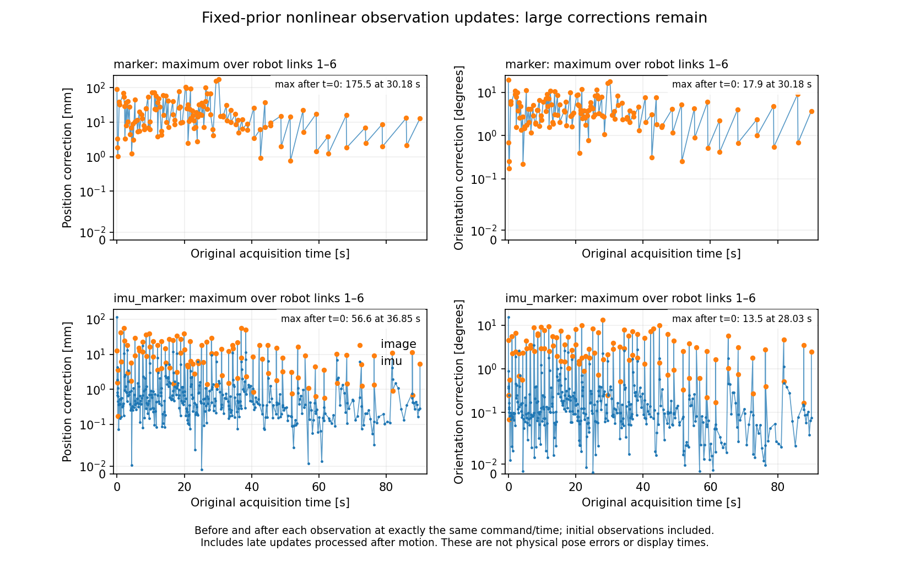

# 非線形更新の実装結果と、残るリンク推定の跳ね

2026年10月18日。非線形更新は実装したが、リンク推定の大きな跳ねは解消していない。MarkerとIMU＋Markerを初期状態から各90秒実行し、同じ取得時刻・実指令に揃えた観測前後の分布で確認した。表示だけの平滑化や観測の棄却は行っていない。

## 今回直した計算と、直っていない挙動

旧方式では、一件の観測中に固定した一次式が予測する改善と、有限な全リンク変換を再合成した結果が一致しない例があった。今回の方式は同じ元事前を固定し、各反復で有限変換を合成して同じ尤度を評価する。全638有効観測・Keep/Resetの1,276枝で、solver点と再合成後の観測残差の最大絶対差は $4\times10^{-15}$ 未満だった。同じ観測を反復ごとに再融合していない。

一方、非初期観測の最大リンク位置補正はMarkerで175.49 mm、IMU併用で56.55 mmだった。方位の最大補正はそれぞれ0.3117 rad、0.2359 radである。初回観測による剛体事前からの補正と、動作途中の補正を分けた。[全選択観測の系列](link_update_series.json)と[詳しい診断](jump_diagnosis/DIAGNOSIS.md)に記録した。

図はリンク1〜6の最大補正であり、真の物理姿勢誤差や画面上の採用時刻ではない。初回観測と動作終了後の遅着推定も含む。全rawを融合した図ではなく、時間を均等に覆う選択で実際に融合した全638観測の図である。

## 最大の跳ねは、外れた画像観測へ追従して戻る過程だった

Markerの29.424秒の画像では、有効なIDは17の一つだった。このIDのnativeな2候補は、取得時刻の真のカメラ相対姿勢に対して両方とも外れていた。

| native候補 | 位置誤差 | 方位誤差 | 元のlog weight |
|---|---:|---:|---:|
| dominant | 69.13 mm | 0.56084 rad | −0.0000208 |
| 他方 | 17.90 mm | 0.32106 rad | −10.78136 |

次の30.182秒の画像では、中央観測の誤差は1.53 mm、0.01997 radへ戻った。この画像間の実カメラ相対姿勢の変化は23.34 mm・0.02004 radだったが、中央観測は76.34 mm・0.58956 rad変化した。身体推定は外れた画像へ追従してから戻り、後者でlink6の175.49 mm補正が生じた。

真値との照合は保存した実関節角とURDFによる独立した後解析だけに使った。真姿勢・真Kを尤度、BFS、IK、推定候補の選定へ入力していない。元の各native候補・全共分散・log weightと、真値を使う後解析を[別記録](jump_diagnosis/raw_native_modes_physical_oracle_compact.json)に分けた。

この画像は1 IDなので、別IDとの中間融合・中間単峰化は存在しない。全native枝を最後まで残して最終一回だけ縮約する独立比較でも、当該画像の中央観測は位置差0、姿勢差 $1.32\times10^{-15}$ radで同じだった。前後画像についても512枝・16枝を削除せず比較した。[比較報告](board_projection_comparison/README.md)に近似差と限界を記録した。

## BFS・最適化・Kを分けて調べた

30.182秒の画像に対するKeepの最終 $\Phi$ は328.272、Resetは8.087だった。GN-Laplaceのlog evidenceはそれぞれ−306.377、5.293で、log Bayes factorは311.670となった。Keep/Resetとも同じnative尤度を使っている。Resetは6反復・score約 $4.87\times10^{-8}$ で、当該モデルではResetが圧倒的に支持された。

4つの決定論的起点から同じ関数を独立に解き直した検査では、選んだ4異常画像・両親について、保存点からの $\Phi$ 改善は最大 $5.35\times10^{-9}$ だった。この検査で大域最適性を証明したわけではないが、大きく解き損なった局所解が今回のBayes factorを作ったという証拠は得られなかった。[再最適化](jump_diagnosis/multistart.json)に記録した。

外れ画像とその次画像の身体推定が受理された時点では、同じK packetが保持されていた。身体はK完了を待たず受理されている。この対の跳ねを、新しいKの同時採用だけでは説明できない。

現行の変化仮説は、保持した身体と、直接指定した身体分布へ戻すResetを比較する。画像候補の全てが外れた場合に「観測自体が失敗した」と説明する別の尤度仮説は定義されていない。そのため、外れた画像を身体変化として説明してしまう場合が残る。観測を無断で捨てる・分散を増す・身体表示だけを滑らかにする変更では解決扱いにしない。次に観測失敗モデルを定義するか、検出器側の候補構成を改修するかは別のモデル設計として区別する。

保持地図の根元座標での絶対誤差が約168〜170 mmあることも別に確認した。カメラ相対姿勢の改善と、身体・地図の絶対姿勢の識別は同じ問題ではない。今回の画像外れだけで、全ての絶対姿勢誤差を説明したとはしない。

## 実動作・時間対応・配信の検証

| 項目 | Marker | IMU＋Marker |
|---|---:|---:|
| 90秒の最終実手先誤差 | 60.32 mm | 64.62 mm |
| 物理実測 | 53.36 Hz | 47.15 Hz |
| 画像実測 | 10.52 Hz | 10.05 Hz |
| 指令規準更新の実測 | 5.67 Hz | 5.17 Hz |
| 有効融合観測 | 137 | 501 |
| K完了／保存job（初期含む） | 66／138 | 76／502 |

両方とも到達未達であり、目標周波数も未達である。90秒の動作と、その後の最大60秒の推定drainを分けた。身体処理は完了したが、Kは72件・426件が未完で、全因子・実ledgerとともにarchiveへ残している。全処理完了とは主張しない。干渉判定は今回OFFなので、無干渉の成功条件も検証していない。

原取得ID・t/q・sequence、実行済み凍結Kのledger、全共同身体／目標lawの数値出自を全11,241 raw・全640 K archiveで照合した。全1,003保存候補のROS marker wireは保存queryからの再生成と全212,278,197 byte一致した。実採用候補と遅着artifactの同一性を確認したもので、現時点の制御候補と遅れた画面が常に同時だという意味ではない。[実走の独立監査](run/README.md)に取得・融合・採用・表示・K待ちを分けて記録した。

## 版と保存範囲

実走は1,124テスト通過のsourceで固定した。実走後に非軸方向の厳密なIMU反平行点のdomain判定を修正し、release版は全1,126テストを通過した。実走の全400有効IMU・800親を旧evaluatorの軌道で再現し、全2,452評価点の残差・Jacobianが修正後とraw array bytesまで一致した。release版で再度90秒実走したという主張とは区別する。

このfolderは説明・要約・監査・代表RViz画像だけをGitへ入れる。全raw画像・SQLite・pickle・巨大ログ・全行列は `/tmp/probtf_nonlinear_fixed_prior_live_20261018` と各独立監査folderに保持し、push対象へ含めない。coreとRViz等の保護対象214ファイルはbaselineと全バイト一致した。
